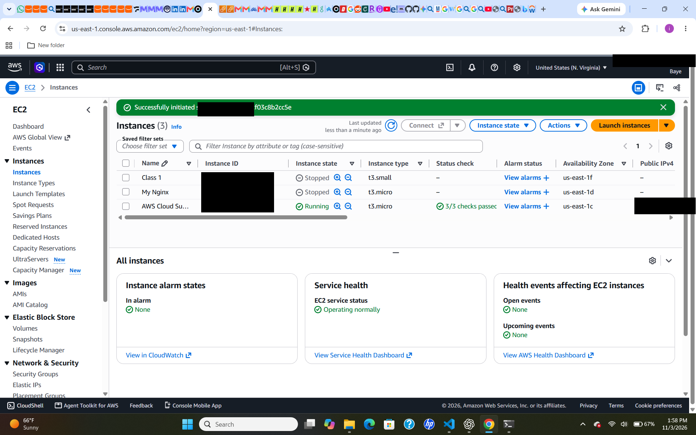
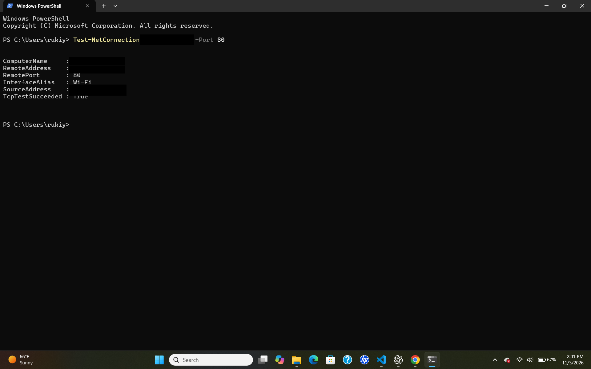
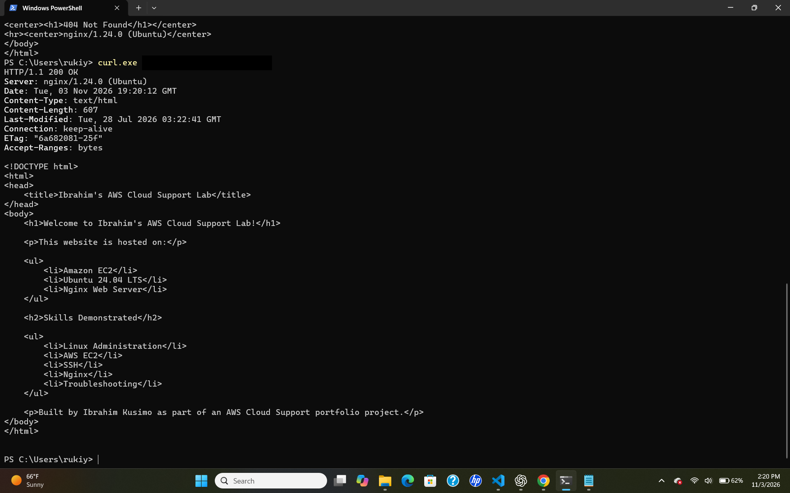

# TCP Connectivity vs HTTP Availability

## Practical 2 — Cloud Support Networking Lab

## 1. Project Overview

This practical demonstrates the difference between TCP connectivity and HTTP application-level responses using an Nginx web server hosted on an AWS EC2 instance.

The objective was to verify TCP connectivity to the web server, test a successful HTTP request, and demonstrate how an HTTP 404 response differs from a network connectivity failure.

The investigation used Windows PowerShell as the external client and an Ubuntu EC2 instance running Nginx as the web server.

---

## 2. Objective

Understand why successful TCP connectivity does not necessarily mean that an HTTP request will return the expected resource.

The practical focused on:

- Testing TCP connectivity to port 80.
- Validating HTTP availability.
- Identifying a successful HTTP 200 response.
- Demonstrating an HTTP 404 response.
- Understanding the difference between transport-layer connectivity and application-layer responses.
- Using command-line tools to troubleshoot connectivity and application behaviour.

---

## 3. Environment

| Component | Configuration |
|---|---|
| Cloud Provider | AWS |
| Compute | Amazon EC2 |
| Operating System | Ubuntu 24.04 LTS |
| Web Server | Nginx |
| Client | Windows PowerShell |
| Protocol | HTTP |
| TCP Port | 80 |
| Network | AWS VPC |

---

## 4. Test Results

The practical involved three tests performed from an external Windows PowerShell client.

### 4.1 TCP Connectivity Test

TCP connectivity to port 80 on the EC2 instance was tested using:

```powershell
Test-NetConnection <EC2_PUBLIC_IP> -Port 80
```

The result was:

```text
RemotePort       : 80
TcpTestSucceeded : True
```

**Finding:** The TCP connection to port 80 was successful. This confirmed that the destination was reachable on the tested port.

### 4.2 HTTP 404 Response

A request was sent to a nonexistent webpage:

```powershell
curl.exe -i http://<EC2_PUBLIC_IP>/this-page-does-not-exist
```

The server returned:

```text
HTTP/1.1 404 Not Found
Server: nginx/1.24.0 (Ubuntu)
```

**Finding:** Nginx successfully received and processed the HTTP request but could not find the requested resource.

This was an HTTP application-level response, not a TCP connectivity failure.

### 4.3 HTTP 200 Response

The actual homepage was tested:

```powershell
curl.exe -i http://<EC2_PUBLIC_IP>/
```

The server returned:

```text
HTTP/1.1 200 OK
Server: nginx/1.24.0 (Ubuntu)
```

The response included the custom AWS Cloud Support Lab webpage.

**Finding:** Nginx successfully served the requested homepage.

---

## 5. Technical Analysis

The results demonstrated that TCP connectivity and HTTP availability are separate aspects of network troubleshooting.

### 5.1 TCP Connectivity

The successful TCP connection confirmed that the EC2 instance was reachable on port 80.

The test did not establish whether every HTTP resource hosted by Nginx was available.

### 5.2 HTTP 404 Response

The HTTP 404 response confirmed that:

* The TCP connection was successful.
* Nginx received the HTTP request.
* The web server processed the request.
* The requested resource could not be found.

### 5.3 HTTP 200 Response

The HTTP 200 response confirmed that:

* TCP connectivity was working.
* Nginx was responding to HTTP requests.
* The requested homepage was available.
* The server successfully returned the expected webpage.

**Key observation:** An HTTP 404 response does not indicate a network connectivity failure. It indicates that the server could not find the requested resource.

---

## 6. Lessons Learned

This practical reinforced several important Cloud Support concepts:

* Successful TCP connectivity does not guarantee that an application or requested resource is available.
* TCP connectivity testing and HTTP testing serve different troubleshooting purposes.
* `Test-NetConnection` can verify whether a TCP port is reachable.
* `curl` can be used to inspect HTTP responses from a web server.
* HTTP 200 indicates that the requested resource was successfully returned.
* HTTP 404 indicates that the server could not find the requested resource.
* A functioning network connection does not automatically mean that an application is functioning as expected.
* Troubleshooting should distinguish between network-layer problems and application-level problems.

**Key takeaway:** Always investigate both network connectivity and application responses when troubleshooting cloud-hosted services.

---

## 7. Cloud Support Skills Demonstrated

This practical demonstrates hands-on experience with:

* TCP connectivity testing.
* HTTP protocol troubleshooting.
* AWS EC2 connectivity validation.
* Linux and Nginx web server fundamentals.
* Windows PowerShell networking tools.
* HTTP status code interpretation.
* Application-level troubleshooting.
* Distinguishing network failures from application responses.
* Evidence-based technical investigation.
* Technical documentation and root cause analysis.

---

## 8. Interview Talking Points

### Scenario

I wanted to verify whether successful TCP connectivity to an AWS-hosted web server guaranteed that the requested HTTP resource was available.

### Investigation

I used `Test-NetConnection` from Windows PowerShell to verify TCP connectivity to port 80. I then used `curl` to test both the actual homepage and a nonexistent webpage.

### Results

The TCP test succeeded. The homepage returned HTTP 200 OK, while the nonexistent webpage returned HTTP 404 Not Found.

### Conclusion

The exercise demonstrated that successful TCP connectivity does not guarantee that every application resource is available.

### Key Takeaway

Cloud Support engineers should validate both network connectivity and application-level responses when troubleshooting cloud-hosted services.

---

## 7. Evidence Screenshots

### 7.1 EC2 Instance Status



### 7.2 TCP Connectivity Test



### 7.3 HTTP 200 Response

 
